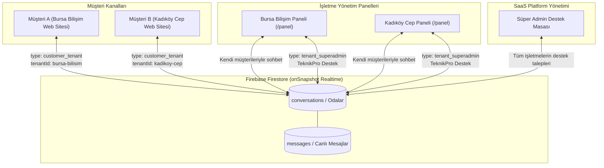
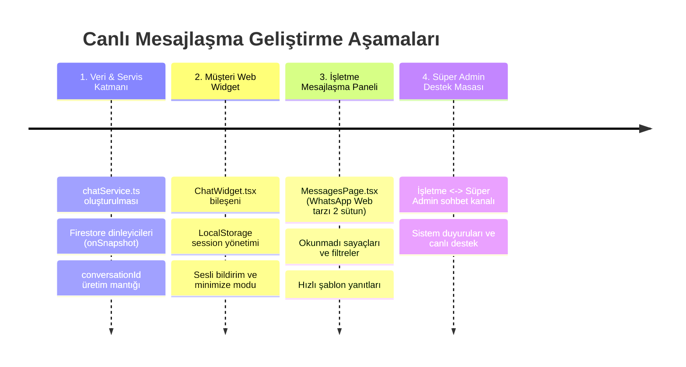

# 💬 TeknikPro Canlı Mesajlaşma Sistemi Mimarisi & Uygulama Rehberi

Bu belge; **İşletme ile Müşteri** arasındaki canlı web sohbeti ve **Süper Admin ile İşletmeler** arasındaki kurumsal destek mesajlaşma sisteminin mimari tasarımını, veri izolasyon kurallarını ve teknik uygulama adımlarını içerir.

---

## 1. Genel Mimari Bakış

Sistem, iki ana mesajlaşma kanalını tek bir esnek ve gerçek zamanlı (real-time) veritabanı çatısı altında toplar:



---

## 2. Müşteri Mesajlarının Birbirine Karışmasını Önleme Yöntemleri

> [!IMPORTANT]
> Müşterilerin mesajlarının karışmasını engellemek için **3 Katmanlı İzolasyon Stratejisi** uygulanır:

| İzolasyon Katmanı | Nasıl Çalışır? | Sağladığı Güvence |
| :--- | :--- | :--- |
| **1. Session ID (Oda İzolasyonu)** | Her yeni ziyaretçiye tarayıcısında (`localStorage`) benzersiz bir `sessionId` atanır (`sess_9f2k1...`). | Müşteri A sayfayı yenilese bile sadece kendi odasını dinler. Müşteri B'nin mesajını asla göremez. |
| **2. Multi-Tenant Etiketi (`tenantId`)** | Her konuşma ve mesaj doğrudan işletmenin kimliğiyle mühürlenir (`tenantId: 'bursa-bilisim'`). | Bursa Bilişim'in paneli sadece kendi `tenantId`'sine sahip konuşmaları sorgular (`where('tenantId', '==', currentTenant.id)`). |
| **3. Firestore Güvenlik Kuralları** | Yetkilendirme kuralları (Security Rules) ile müşteri yalnızca kendi `conversationId`'sine okuma/yazma yapabilir. | Ağ trafiğini inceleyen biri dahi başkasına ait oda kimliğini bilmeden veya yetkisi olmadan mesaj çekemez. |

---

## 3. Firestore Veri Şeması (Data Schema)

### A. `conversations` Koleksiyonu (Konuşma Odaları)
Her bir müşteri-işletme veya işletme-admin diyaloğu için tekil bir belge:

```typescript
export interface Conversation {
  id: string;                         // örn: "conv_bursa_cust_a8f9c1"
  type: 'customer_tenant' | 'tenant_superadmin';
  tenantId: string;                   // "bursa-bilisim"
  tenantName: string;                 // "Bursa Bilişim"

  // Müşteri Bilgileri (Yalnızca type === 'customer_tenant' ise)
  customer?: {
    sessionId: string;                // Tarayıcıdaki tekil anahtar
    name: string;                     // "Ahmet Yılmaz" (veya "Ziyaretçi #402")
    phone?: string;                   // "0532 111 22 33"
    serviceCode?: string;             // İlgili servis takip no (varsa)
  };

  // Son Mesaj Özeti (Sol liste performansı için)
  lastMessage: string;                // "Ekran değişimi için fiyat alabilir miyim?"
  lastMessageAt: any;                 // Firestore ServerTimestamp
  lastSenderType: 'customer' | 'tenant' | 'superadmin';

  // Okunmamış Mesaj Sayaçları (Kırmızı rozetler için)
  unreadCountTenant: number;          // İşletmenin okumadığı mesaj sayısı
  unreadCountCustomer: number;        // Müşterinin okumadığı mesaj sayısı
  unreadCountSuperAdmin: number;      // Süper adminin okumadığı mesaj sayısı

  status: 'active' | 'resolved' | 'archived';
  createdAt: any;
  updatedAt: any;
}
```

### B. `messages` Koleksiyonu (Canlı Mesaj Akışı)
Tüm odaların mesajları bu koleksiyonda indekslenir (veya `conversations/{id}/messages` alt koleksiyonunda tutulur):

```typescript
export interface ChatMessage {
  id: string;                         // msg_1728391209
  conversationId: string;             // Bağlı olduğu konuşma odası
  tenantId: string;                   // Multi-tenant doğrulaması
  senderType: 'customer' | 'tenant' | 'superadmin';
  senderId: string;                   // SessionId veya User UID
  senderName: string;                 // Gönderenin adı
  text: string;                       // Mesaj içeriği
  attachments?: {
    type: 'image' | 'file';
    url: string;
    name: string;
  }[];
  isRead: boolean;
  createdAt: any;                     // Firestore ServerTimestamp
}
```

---

## 4. Kullanıcı Deneyimi ve Arayüz Akışı

### 1. Ziyaretçi / Müşteri Deneyimi (İşletme Web Sitesi)
- İşletmenin web sayfasının sağ altında göze batmayan, işletmenin marka rengine bürünen **yüzen canlı sohbet butonu (Floating Widget)** yer alır.
- Tıklandığında açılan şık pencere:
  1. **İlk Karşılama:** *"Merhaba! Bursa Bilişim teknik servisine hoş geldiniz. Size nasıl yardımcı olabiliriz?"*
  2. **İsim & Telefon Girişi (İsteğe Bağlı):** Müşteri adını/telefonunu girdiğinde, konuşma işletme panelinde doğrudan müşteri profiliyle eşleşir.
  3. **Canlı Akış:** Müşteri yazdığında Firestore `onSnapshot` ile anında işletmeye iletilir. İletildi ve okundu bildirimleri görülür.

### 2. İşletme Yönetim Paneli (`/panel/mesajlar`)
- Sol tarafta gelen müşteri mesajları listesi (Whatsapp Web düzeni):
  - Müşteri adı, son mesaj saati, okunmadı rozeti.
  - "Servis Kayıtlı Müşteri" ise yanında cihaz modeli ve takip numarası ipucu.
- Sağ tarafta canlı mesajlaşma alanı ve hızlı hazır cevap butonları (Örn: *"Cihazınızı servisimize bekleriz"*, *"Arıza tespitimiz ücretsizdir"*).
- Üst sekmede **"Platform Desteği (TeknikPro)"** butonu ile doğrudan Süper Admin ile yazışma.

### 3. Süper Admin Paneli (`/admin/destek`)
- SaaS platformuna abone tüm işletmelerin teknik/idari sorularını gördüğü merkezi bilet & sohbet ekranı.

---

## 5. Adım Adım Uygulama Yol Haritası



> [!TIP]
> **Firebase Firestore'un Avantajı:** Ayrı bir Node.js socket sunucusu gerektirmediği için Vercel üzerinde %100 kesintisiz, sıfır ek maliyetle ve otomatik yeniden bağlanma desteğiyle çalışır.
