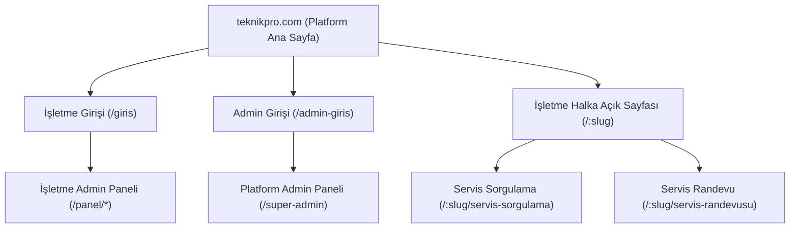

# 🏗️ TeknikPro Multi-Tenant Dönüşüm Planı

## 📋 Genel Bakış

Mevcut TeknikPro uygulamasını **3 katmanlı bir yapıya** dönüştüreceğiz:



---

## 🎯 Sayfa Hiyerarşisi

| Sayfa | URL | Erişim | Açıklama |
|-------|-----|--------|----------|
| **Platform Ana Sayfa** | `/` | Herkese açık | TeknikPro SaaS hizmetini tanıtan pazarlama sayfası |
| **İşletme Girişi** | `/giris` | Herkese açık | İşletme personeli login ekranı |
| **Admin Girişi** | `/admin-giris` | Herkese açık | Platform sahibi (super-admin) login ekranı |
| **İşletme Halka Açık Sayfası** | `/:slug` | Herkese açık | İşletmeye özel marka/renk/logo ile tasarlanmış tanıtım sayfası |
| **Servis Sorgulama** | `/:slug/servis-sorgulama` | Herkese açık | İşletmeye özel servis takip sayfası |
| **Servis Randevu** | `/:slug/servis-randevusu` | Herkese açık | İşletmeye özel randevu alma sayfası |
| **İşletme Admin Paneli** | `/panel/*` | Yetkilendirilmiş | İşletme yönetim paneli (mevcut) |
| **Super Admin Paneli** | `/super-admin` | Yetkilendirilmiş | Platform sahibi yönetim paneli (mevcut) |

---

## 📦 Faz 1: Tenant Model Güncelleme

### 1.1 — `Tenant` Tipine Yeni Alanlar Ekleme

Mevcut `Tenant` interface'ine aşağıdaki alanlar eklenecek:

```typescript
// types/index.ts - Tenant interface'ine eklenecekler
export interface Tenant {
  // ... mevcut alanlar ...

  // 🆕 Branding / Görsel Kimlik
  logoUrl?: string;              // İşletme logosu URL'si
  faviconUrl?: string;           // Tarayıcı favicon
  coverImageUrl?: string;        // Kapak görseli (hero banner)

  // 🆕 Tema Renkleri
  theme?: TenantTheme;

  // 🆕 İşletme Detay Bilgileri
  description?: string;          // İşletme açıklaması (halka açık sayfada gösterilir)
  shortDescription?: string;     // Kısa açıklama (slogan)
  city?: string;                 // Şehir
  district?: string;             // İlçe
  googleMapsUrl?: string;        // Google Maps embed linki
  latitude?: number;             // Konum enlem
  longitude?: number;            // Konum boylam
  workingHours?: string;         // Çalışma saatleri (Pzt-Cum 09:00-18:00)
  socialMedia?: {
    instagram?: string;
    facebook?: string;
    twitter?: string;
    whatsapp?: string;
  };

  // 🆕 Hizmet Bilgileri
  services?: string[];           // Sunulan hizmetler listesi (ör: "Telefon Tamiri", "Tablet Onarımı")
  deviceBrands?: string[];       // Desteklenen cihaz markaları
}

export interface TenantTheme {
  primaryColor: string;          // Ana renk (ör: #0071e3)
  secondaryColor: string;        // İkincil renk (ör: #34c759)
  accentColor?: string;          // Vurgu rengi
  backgroundColor?: string;     // Arka plan rengi
  textColor?: string;            // Metin rengi
  gradientFrom?: string;        // Gradient başlangıç
  gradientTo?: string;           // Gradient bitiş
  darkMode?: boolean;            // Koyu tema tercihi
}
```

### 1.2 — Backend Model Güncelleme

[Models.cs](file:///c:/Users/brky_/.gemini/antigravity-ide/scratch/teknikpro/backend/TeknikPro.API/Models/Models.cs) dosyasındaki `Tenant` sınıfına aynı alanlar eklenecek.

---

## 📦 Faz 2: Platform Ana Sayfa (Landing Page)

### 2.1 — Yeni Dosya: `pages/landing/LandingPage.tsx`

Mevcut `HomePage.tsx` → tek bir işletmenin müşterilerine yönelik. Bu dosya kalacak ve `/:slug` rotasına taşınacak.

**Yeni `LandingPage.tsx`** → TeknikPro'nun SaaS platformunu tanıtan pazarlama sayfası olacak.

#### İçerik bölümleri:
1. **Hero Section** — "Teknik Servis Yönetiminde Yeni Nesil" başlığı, CTA butonları
2. **Özellikler** — Online randevu, servis takip, stok yönetimi, müşteri CRM, raporlama, çoklu şube
3. **Nasıl Çalışır?** — 3 adım: Kayıt ol → Ayarla → Başla
4. **Fiyatlandırma** — Starter / Pro / Enterprise paketleri
5. **Demo İşletmeler** — Kayıtlı işletmelerin kartları (logoları ve kısa açıklamaları ile)
6. **İletişim & Footer** — İletişim bilgileri ve login linkleri

#### Navbar'da:
- **İşletme Girişi** butonu → `/giris`
- **Admin Girişi** butonu → `/admin-giris`
- **Demo Deneyin** butonu → Demo işletme slug'ına yönlendirme

### 2.2 — Yeni Dosya: `pages/landing/LandingPage.css`

Premium, modern, dark-mode landing page tasarımı.

---

## 📦 Faz 3: İşletme Halka Açık Sayfası (Tenant Public Page)

### 3.1 — Yeni Dosya: `pages/tenant-public/TenantPublicPage.tsx`

URL: `/:slug` — Slug'a göre Firestore'dan tenant bilgileri çekilecek.

#### Dinamik Tema Sistemi:
- İşletmenin `theme` ayarlarına göre CSS custom properties set edilecek
- Logo, kapak görseli, açıklama, iletişim bilgileri dinamik olarak render edilecek
- Her işletme farklı renk paleti ve görsellerle kendi sayfasına sahip olacak

#### Sayfa Bölümleri:
1. **Navbar** — İşletme logosu, adı, servis sorgula / randevu al linkleri
2. **Hero** — İşletme kapak görseli + slogan + CTA butonları
3. **Hizmetlerimiz** — İşletmenin sunduğu hizmet kartları (tenant.services dizisinden)
4. **Hakkımızda** — İşletme açıklaması (tenant.description)
5. **Nasıl Çalışır** — 4 adım (mevcut ile benzer ama işletme temasında)
6. **İletişim** — Telefon, adres, e-posta, çalışma saatleri, Google Maps embed
7. **Footer** — "TeknikPro altyapısı ile çalışmaktadır" powered-by notu

### 3.2 — Dinamik CSS Theming

```tsx
// TenantPublicPage.tsx içinde
useEffect(() => {
  const root = document.documentElement;
  if (tenant?.theme) {
    root.style.setProperty('--tenant-primary', tenant.theme.primaryColor);
    root.style.setProperty('--tenant-secondary', tenant.theme.secondaryColor);
    root.style.setProperty('--tenant-accent', tenant.theme.accentColor || tenant.theme.primaryColor);
    // ... diğer tema değişkenleri
  }
  return () => {
    // cleanup: tema değişkenlerini temizle
  };
}, [tenant]);
```

### 3.3 — Tenant Servis Sorgulama & Randevu Sayfaları

Mevcut `TrackingPage.tsx` ve `BookingPage.tsx` dosyaları düzenlenecek:
- URL: `/:slug/servis-sorgulama` ve `/:slug/servis-randevusu`
- Slug parametresine göre tenant teması uygulanacak
- İşletme logosu ve renkleri kullanılacak

---

## 📦 Faz 4: Giriş Sayfaları Ayrımı

### 4.1 — Mevcut Login Güncelleme: `/giris`

Mevcut [Login.tsx](file:///c:/Users/brky_/.gemini/antigravity-ide/scratch/teknikpro/frontend/src/pages/auth/Login.tsx) işletme personeli girişi için kullanılacak:
- İşletme seçimi (dropdown veya slug girişi) eklenecek
- Giriş sonrası `/panel` paneline yönlendirecek

### 4.2 — Yeni Dosya: `pages/auth/AdminLogin.tsx`

Platform sahibi (super-admin) girişi:
- URL: `/admin-giris`
- Farklı tasarım (Crown ikonu, "Platform Yönetimi" başlığı)
- Giriş sonrası `/super-admin` paneline yönlendirecek

---

## 📦 Faz 5: İşletme Kayıt Formu Güncelleme

### 5.1 — SuperAdmin Tenant Oluşturma Modal Güncelleme

Mevcut [SuperAdminDashboard.tsx](file:///c:/Users/brky_/.gemini/antigravity-ide/scratch/teknikpro/frontend/src/pages/super-admin/SuperAdminDashboard.tsx) içindeki "Yeni İşletme Ekle" modalına ek alanlar:

- **Logo yükleme** (Firebase Storage'a upload)
- **Kapak görseli yükleme**
- **Tema renkleri seçimi** (color picker)
  - Ana renk
  - İkincil renk
  - Vurgu rengi
  - Koyu/Açık tema tercihi
- **İşletme açıklaması** (textarea)
- **Kısa açıklama / Slogan**
- **Şehir / İlçe**
- **Google Maps linki**
- **Çalışma saatleri**
- **Sosyal medya linkleri** (Instagram, Facebook, WhatsApp)
- **Sunulan hizmetler** (etiket/tag sistemi)
- **Desteklenen cihaz markaları** (etiket/tag sistemi)

---

## 📦 Faz 6: Routing Güncelleme

### 6.1 — `App.tsx` Route Yapısı

```tsx
<Routes>
  {/* Platform Landing Page */}
  <Route path="/" element={<LandingPage />} />

  {/* Auth */}
  <Route path="/giris" element={<Login />} />
  <Route path="/admin-giris" element={<AdminLogin />} />

  {/* Tenant Public Pages (slug-based) */}
  <Route path="/:slug" element={<TenantPublicPage />} />
  <Route path="/:slug/servis-sorgulama" element={<TrackingPage />} />
  <Route path="/:slug/servis-sorgulama/:id" element={<TrackingPage />} />
  <Route path="/:slug/servis-randevusu" element={<BookingPage />} />

  {/* Backwards compat */}
  <Route path="/takip" element={<Navigate to="/servis-sorgulama" replace />} />
  <Route path="/takip/:id" element={<TrackingPage />} />

  {/* Super Admin Portal */}
  <Route path="/super-admin" element={<SuperAdminDashboard />} />

  {/* İşletme Admin Panel (mevcut) */}
  <Route path="/panel" element={<AdminLayout />}>
    <Route index element={<Dashboard />} />
    <Route path="servisler" element={<ServiceList />} />
    {/* ... mevcut rotalar ... */}
  </Route>

  <Route path="*" element={<Navigate to="/" replace />} />
</Routes>
```

> [!IMPORTANT]
> `/:slug` rotası, mevcut statik rotalarla (`/giris`, `/panel`, `/super-admin`, `/admin-giris`) çakışmaması için, **slug çözümleyici** (resolver) bileşeni kullanılacak. Eğer slug geçerli bir tenant değilse 404 sayfasına yönlendirilecek.

---

## 📦 Faz 7: Dosya Yapısı Özeti

```
frontend/src/
├── pages/
│   ├── landing/                     ← 🆕 Platform pazarlama sayfası
│   │   ├── LandingPage.tsx
│   │   └── LandingPage.css
│   ├── tenant-public/               ← 🆕 İşletme halka açık sayfası
│   │   ├── TenantPublicPage.tsx
│   │   └── TenantPublicPage.css
│   ├── auth/
│   │   ├── Login.tsx                ← ♻️ İşletme girişi (güncellenir)
│   │   ├── Login.css
│   │   ├── AdminLogin.tsx           ← 🆕 Platform admin girişi
│   │   └── AdminLogin.css
│   ├── customer/
│   │   ├── HomePage.tsx             ← 🗑️ Kaldırılacak (LandingPage + TenantPublicPage ile değiştirildi)
│   │   ├── TrackingPage.tsx         ← ♻️ Slug parametresi desteği eklenecek
│   │   └── BookingPage.tsx          ← ♻️ Slug parametresi desteği eklenecek
│   ├── admin/                       ← Mevcut (değişiklik yok)
│   └── super-admin/
│       └── SuperAdminDashboard.tsx   ← ♻️ Tenant oluşturma formu genişletilecek
├── types/
│   └── index.ts                     ← ♻️ Tenant tipi genişletilecek
├── store/
│   └── tenantStore.ts               ← ♻️ Slug ile tenant çekme fonksiyonu eklenecek
└── components/
    └── tenant-theme/                ← 🆕
        └── TenantThemeProvider.tsx   ← Dinamik tema context bileşeni
```

---

## 🔄 Uygulama Sırası

| Adım | Faz | Açıklama | Tahmini Etki |
|------|-----|----------|-------------|
| 1 | Faz 1 | `Tenant` tipine yeni alanlar ekleme (frontend + backend) | Düşük risk |
| 2 | Faz 6 | Route yapısını güncelleme (`App.tsx`) | Orta risk |
| 3 | Faz 2 | Platform Landing Page oluşturma | Yeni sayfa |
| 4 | Faz 4 | Login sayfaları ayrımı (İşletme + Admin) | Düşük risk |
| 5 | Faz 3 | İşletme halka açık sayfası + dinamik tema sistemi | En büyük değişiklik |
| 6 | Faz 5 | Tenant oluşturma formunu güncelleme | Mevcut modal genişletme |
| 7 | — | TrackingPage & BookingPage slug desteği | Mevcut sayfaları güncelleme |
| 8 | — | Test & polish | Final dokunuşlar |

---

## ⚠️ Dikkat Edilecek Noktalar

> [!WARNING]
> - `/:slug` rotası ile statik rotalar (`/giris`, `/panel` vb.) çakışma riski var. **Slug resolver** ile kontrol edilecek.
> - Mevcut `HomePage.tsx` tamamen kaldırılacak; içeriği iki ayrı sayfaya (LandingPage + TenantPublicPage) dağıtılacak.
> - Logo/görsel yükleme Firebase Storage kullanacak.

> [!TIP]
> - Her işletmenin halka açık sayfası, o işletmenin tema renkleriyle tamamen farklı görünecek.
> - "Powered by TeknikPro" footer notu ile platform markası korunacak.
> - Varsayılan tema renkleri belirlenerek, tema ayarı yapmamış işletmeler için de şık bir görünüm sağlanacak.

---

**Onayınızı bekliyorum. Onay sonrası Faz 1'den başlayarak sırayla uygulayacağım.** 🚀
